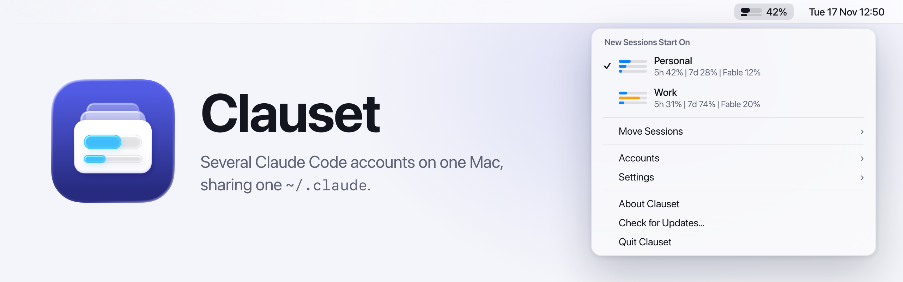

<picture>
  <source media="(prefers-color-scheme: dark)" srcset=".github/header-dark.png">
  
</picture>

# Clauset

[](https://github.com/mischasigtermans/clauset/releases)
[](LICENSE)

Several Claude Code accounts on one Mac, sharing one `~/.claude`.

Each account keeps its own sign-in in its own config directory. Everything else is shared from `~/.claude`: settings, `CLAUDE.md`, rules, skills, plugins, MCP servers, sessions and auto-memory. A `claude` shim starts a new session on the default account, or on the account of the session that started it, and `clauset switch` moves a running session to another account when the one it runs on nears its limit. Clauset reads no token and makes no network call. Only the official `claude` binary talks to Anthropic. The menu bar app asks before it goes online. With your yes it fetches its release feed from GitHub once a week, and it downloads a newer version from there when you choose to install it.

## Installation

Download [Clauset.dmg](https://github.com/mischasigtermans/clauset/releases/latest/download/Clauset.dmg) and drag Clauset to Applications, or install it with Homebrew:

```sh
brew install --cask mischasigtermans/tap/clauset
```

The app carries the `clauset` CLI and walks you through setup. It needs macOS 14.4 or later.

For the CLI without the app:

```sh
brew install mischasigtermans/tap/clauset-cli
clauset setup
```

Homebrew builds the latest release from source.

Or with Cargo, from this repository:

```sh
cargo install --locked --git https://github.com/mischasigtermans/clauset
clauset setup
```

`setup` names the account `~/.claude` is signed in to, signs in the others, asks which account new sessions start on, and puts the shim, the hooks, the status line and two skills in place. It asks before each step and skips what's already there. [Install Clauset](docs/start/install.md) covers upgrading, and [What Clauset writes](docs/reference/files.md) lists every file.

### Requires

- macOS: Claude Code keeps each sign-in in the login Keychain.
- Claude Code: tested on 2.1.322. Clauset rests on [behaviour Claude Code doesn't document](docs/reference/undocumented-behaviour.md).
- Rust 1.88 or later to build with Cargo, from [rustup](https://rustup.rs).

## Quick start

```sh
clauset                          # the account here, and every account's usage
clauset use personal             # the account new sessions start on
clauset add work --email me@work.com         # sign in another account
clauset add old --dir ~/.claude-old          # take in a config dir you already use
clauset switch work              # inside a session: move it there
clauset switch work --all        # move every session on this account there
```

```
~/code/app runs on personal  (the default)

→ personal  * Ultra  5h █░░░░░░░░░  12%  resets 14:00   7d ██░░░░░░░░  18%  resets Tue 09:00
                     me@example.com, personal | usage 4 min ago
  work        Team   5h ███░░░░░░░  31%  resets 13:00   7d ██████░░░░  61%  resets Sun 10:00
                     me@work.com, Acme | usage just now
```

The usage comes from what Claude Code stores and hands its status line, so an account shows numbers once a session has run on it.

## Features

- `claude` starts on the account of the session that started it, else on the default. `clauset use <account>` sets the default.
- `clauset switch <account>` moves a running session once its turn is over and resumes it in the same terminal. `--all` moves every session on the account you leave.
- `clauset warn 80` puts up a notification when an account passes 80% of a limit. Which account to go on with stays your choice.
- `clauset chrome <account>` lets every account reach the browser the Claude in Chrome extension is signed in to.
- `clauset run <account> [args]` starts Claude Code on one account, and `clauset status --json` gives the overview to a program.
- `clauset doctor` checks the shim, hooks, skills, status line, and every account's sign-in, Keychain item and links.

## Menu bar app

`macos/` holds Clauset, a menu bar app on top of `clauset status --json`. It shows one account as a meter in the menu bar and every account's limits in its menu, sets the default, moves sessions between accounts and posts Clauset's notifications under its own name.

[The menu bar app](docs/start/menu-bar-app.md) describes its menus, its windows and its updates, and how to build it yourself.

## Documentation

[clauset.app](https://clauset.app) shows Clauset in pictures and holds these pages.

- Start here: [Install Clauset](docs/start/install.md), [Set up your accounts](docs/start/set-up.md), [The menu bar app](docs/start/menu-bar-app.md)
- Accounts: [Which account a session starts on](docs/accounts/which-account.md), [Add, sign in and remove accounts](docs/accounts/add-and-remove.md), [What accounts share](docs/accounts/what-accounts-share.md), [Claude in Chrome on every account](docs/accounts/claude-in-chrome.md)
- Sessions and limits: [Move a session to another account](docs/sessions/move-a-session.md), [Usage and warnings](docs/sessions/usage-and-warnings.md)
- Reference: [The config file](docs/reference/config-file.md), [What Clauset writes](docs/reference/files.md), [Hooks, status line and skills](docs/reference/hooks-status-line-and-skills.md), [For programs and agent tools](docs/reference/programs.md), [Undocumented behaviour](docs/reference/undocumented-behaviour.md)

## Changelog

See [CHANGELOG.md](CHANGELOG.md).

## Credits

- [Mischa Sigtermans](https://mischa.sigtermans.me)
- [larcane97/clausona](https://github.com/larcane97/clausona), for its survey of the state Claude Code keeps per account
- [vika2603/ccs](https://github.com/vika2603/ccs), for the shim on a single `~/.claude`
- [Phosphor Icons](https://phosphoricons.com), for the site's icons, under the MIT licence
- The Homebrew logo, © Homebrew contributors, under the [BSD 2-Clause licence](https://github.com/Homebrew/brew.sh/blob/main/LICENSE.txt)
- The Cargo logo, © the Rust Foundation, under [CC BY 4.0](https://creativecommons.org/licenses/by/4.0/)
- Claude's mark, from [Simple Icons](https://simpleicons.org). Claude is a trademark of Anthropic

## License

MIT. See [LICENSE](LICENSE).
